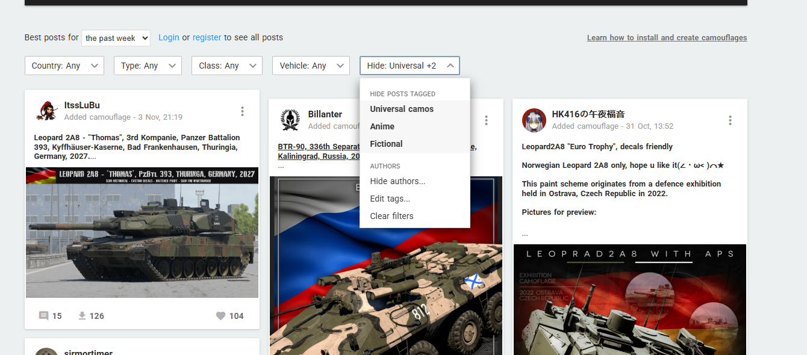

# WT Live Camo Filter

A Tampermonkey userscript that hides universal, anime, and fictional camouflages on the
[War Thunder Live](https://live.warthunder.com/feed/camouflages/) camouflage feed.

The filtering happens before the feed renders, so matching cards do not flash into view and
then disappear.

## Features

- Hide cards by tag group: **Universal camos**, **Anime**, **Fictional**
- Edit the tag lists from the settings panel; tags can be written as `#all_vehicles`,
  `#allvehicles`, or `all vehicles`
- Block specific authors from the post `...` menu, or manage the list manually
- Full post descriptions are fetched through the site's own `/api/posts/get/` endpoint when the
  feed truncates them, so tags at the bottom of a post are still matched
- Post details are cached in `localStorage` (last 250 posts) to keep later feed pages fast
- Visible cards are repacked across the three feed columns so hiding posts does not leave holes
- Settings are stored in `localStorage`

## Install

1. Install [Tampermonkey](https://www.tampermonkey.net/) (or a compatible userscript manager).
2. Open the raw userscript:

   <https://raw.githubusercontent.com/pelvisft/wtlive-camo-filter/main/WT-Live-Camo-Filter.user.js>

   The manager should offer to install it.
3. Open <https://live.warthunder.com/feed/camouflages/>.

Alternatively, create a new script in Tampermonkey and paste the file contents.

## Usage

The control appears in the camouflage feed's filter bar, next to `Vehicle: Any`.

- Click `Hide: ...` to open the tag switches.
- `Edit tags...` opens one textarea per tag group. One tag per line.
- `Hide authors...` manages the blocked-author list. One nickname or numeric user ID per line.
- On a post card, open the `...` menu and choose `Hide this author`.
- `Clear filters` shows everything again.
- `Defaults` in the tag editor restores the shipped tag lists.

## How it works

The site loads the feed over `XMLHttpRequest`. The script hooks that request at
`document-start`, holds the response while it fetches full descriptions for truncated posts,
and appends the missing tag text to the HTML as hidden elements. The feed is then rendered
already filtered.

The script runs with `@grant none`, so it uses only page APIs and `localStorage`; there is no
telemetry and no data leaves the browser except the site's own API requests.

Scope is limited to `/feed/camouflages/`.

## Notes

- Comments in the source are intentionally informal.
- Not affiliated with Gaijin Entertainment, War Thunder, or War Thunder Live.
- The script depends on the site's current markup and API. If WT Live changes either, it may
  need updates.

## License

Public domain under the [Unlicense](LICENSE). No attribution required. Do whatever you want
with it.
